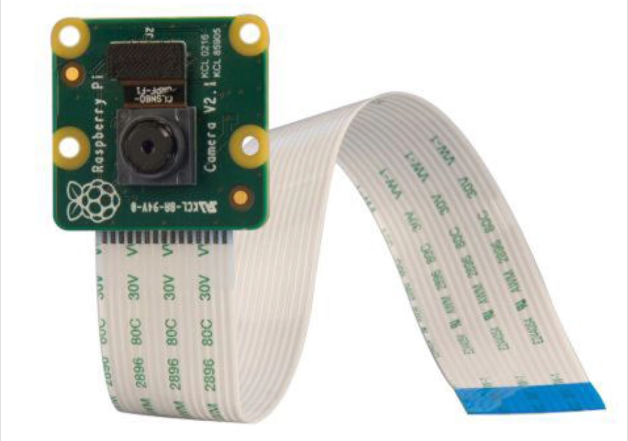
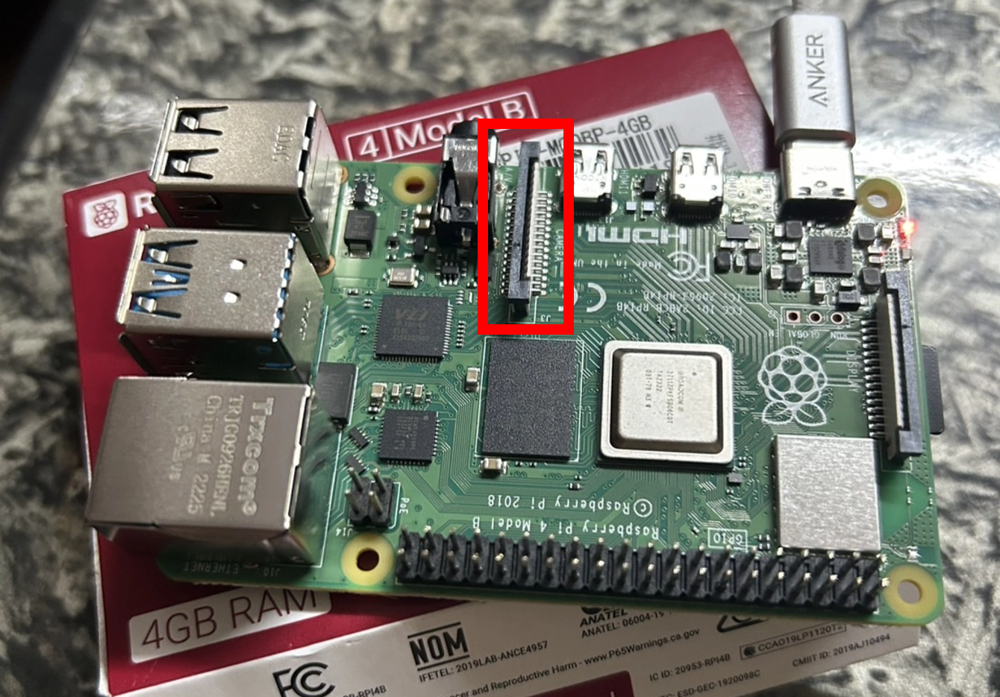

# Raspberry Pi Camera Setup and Testing
This document explains how to install and test a Raspberry Pi Camera Module. 

Reference: 
- [Raspberry Pi Camera Software Documentation](https://www.raspberrypi.com/documentation/accessories/camera-software.html)
- [Picamera2 Official Manual (PDF)](https://datasheets.raspberrypi.com/camera/picamera2-manual.pdf)

## 1. Install the Camera Module
Before connecting the camera, **DISCONNECT the power from the Raspberry Pi**.
1. Locate the camera connector (CSI) on the Raspberry PI as shown in Figure below. 
2. Gently pull up the black locking mechanism.
3. Insert the camera ribbon cable into the connector, keep the blue side face to the 3.5 mm audio jack side or Ethernet.
4. Push the black locking mechanism back down to secure the cable. 

<div style="width: 100%; max-width: 1200px; margin: 0 auto;">
  <table style="border-collapse: collapse; width: 100%;">
    <tr>
      <td style="width: 50%; padding: 10px;">
        
        <p style="text-align: center;"><strong>Camera Module</strong></p>
      </td>
      <td style="width: 50%; padding: 10px;">
        
        <p style="text-align: center;"><strong>Camera Connector CSI</strong></p>
      </td>
    </tr>
  </table>
</div>


## 2. Check the Installed Camera Utilities
Different Raspberry Pi OS versions use different camera utilities.

| Raspberry Pi OS                | Camera Utility    |
| ------------------------------ | ----------------- |
| Bullseye (Debian 11, Outdated) | `libcamera-hello` |
| Bookworm (Debian 12, Legacy)   | `rpicam-hello`    |
| Trixie (Debian 13) or newer    | `rpicam-hello`    |

Note: **Outdated OS (Bullseye or older)** hereafter is referred as **older OS**.

Check which utility is installed:
```bash
# Older Raspberry Pi OS (Bullseye)
which libcamera-hello

# Newer Raspberry Pi OS (Bookworm / Trixie)
which rpicam-hello
```
If neither command return a path, install the camera applications:
```bash
sudo apt update
sudo apt install rpicam-apps
```
**Note**: The installed utility depends on the Raspberry Pi OS version.

To check your current OS version:
```bash
cat /etc/os-release
```
For example, my Raspberry Pi uses:
```bash
PRETTY_NAME="Raspbian GNU/Linux 13 (trixie)"
VERSION_ID="13"
VERSION="13 (trixie)"
VERSION_CODENAME=trixie
```
Therefore, I use `rpicam-hello` instead of `libcamera-hello`.

## 3. Check Camera Detection
After connecting the camera and installing the necessary utilities, check whether the Raspberry Pi detects the camera.
```bash
# Newer Raspberry Pi OS
rpicam-hello --list-cameras

# Older Raspberry Pi OS
libcamera-hello --list-cameras
```
If the camera is detected successfully, you should see information about the connected camera, including its name and supported resolution.
For example:
```bash
Available cameras
-----------------
0 : imx708_wide [4608x2592 10-bit RGGB] (/base/soc/i2c0mux/i2c@1/imx708@1a)
    Modes: 'SRGGB10_CSI2P' : 1536x864 [120.13 fps - (768, 432)/3072x1728 crop]
                             2304x1296 [56.03 fps - (0, 0)/4608x2592 crop]
                             4608x2592 [14.35 fps - (0, 0)/4608x2592 crop]
```
If no camera is detected, check:
- **Ribbon cable**: Check if ribbon is inserted correctly (blue side needs to face to Ethernet.)
- **Camera Compatibility**: Check if the camera module is compatible with your Raspberry Pi model.
- **Software Compatibility**: Check if your Raspberry Pi OS supports the camera interface and driver stack.

## 4. Test the Camera Preview
Once the camera is detected, test whether it works properly by opening the camera preview.
```bash
# Newer Raspberry Pi OS
rpicam-hello

# Older Raspberry Pi OS
libcamera-hello 
```
The preview will open for 5000 milliseconds (5 seconds) as default. You can add `-t <duration>` argument specifies the preview duration in milliseconds.
For example:
```bash
# Open preview for 10 seconds
rpicam-hello -t 10000
```

If the preview opens and displays the camera feed correctly, the camera is working.

## 5. Python API test
The Raspberry Pi Camera Module can be controlled by using `picamera2` library which is pre-installed on standard Raspberry PI OS images (Bullseye, Bookworm, Trixie and newer versions). 
But if it is missing due to minimal installation, you can install it manually:
```bash
sudo apt update
sudo apt install python3-picamera2
```
You can check the detailed documentation on the [Picamera2 Official Manual (PDF)](https://datasheets.raspberrypi.com/camera/picamera2-manual.pdf). This section provides brief examples of ordinary Picamera2 API usage.
This section provides brief examples of ordinary Picamera2 API usage.

5.1. `camera_test.py` — Basic Camera Test

Demonstrates how to initialize Picamera2, configure the camera preview, and capture an image.
- Initialize the Picamera2 instance.
- Create and configure a preview configuration (refer to [picamera_functions.md](picamera_functions.md) ***Section 3**: Camera Previwew*).
- Start the camera.
- Capture and save an image using `switch_mode_and_capture_file()` (other functions can be used, refer to [picamera_functions.md](picamera_functions.md) ***Section 1**: Image Capture*).

5.2. `camera_test_picamCV.py` — Picamera2 + **OpenCV**

Demonstrates how to retrieve camera frames using Picamera2 and display them using **OpenCV**.
- Initialize and configure Picamera2.
- Capture frames as NumPy arrays using `capture_array()` (refer to [picamera_functions.md](picamera_functions.md) ***Section 1**: Image Capture*).
- Display the captured frames using `cv2.imshow()`.
- Provide image frames ready for further image processing using **OpenCV**.

5.3. `camera_test_video.py` — Video Recording

Demonstrates how to record video using Picamera2.
- Initialize and configure the camera for video recording.
- Set up a video encoder (e.g., H264Encoder).
- Start recording using start_recording().
- Stop recording using stop_recording().
Note: The video recording example is an additional test demonstrating continuous video capture and encoding. It might not be used for simple autonomous racing car purposes.


## Appendix 
### Camera Software: Legacy V4L2 vs. Modern libcamera

**Older Raspberry Pi OS** versions (such as Bullseye or older) supported the legacy Broadcom camera stack, which included MMAL and the legacy V4L2 camera driver.

**Newer Raspberry Pi OS** versions (Bookworm and Trixie or newer) use the modern libcamera-based camera stack, now exposed through the rpicam applications.

**Why does this matter for OpenCV?**

OpenCV's standard camera interface:
```bash
import cv2

cap = cv2.VideoCapture(0)
```
typically relies on a V4L2 video device such as `/dev/video0`.

Since modern camera stack does not support V4L2 video device, `cv2.VideoCapture(0)` may successfully open a device but fail to retrieve frames.