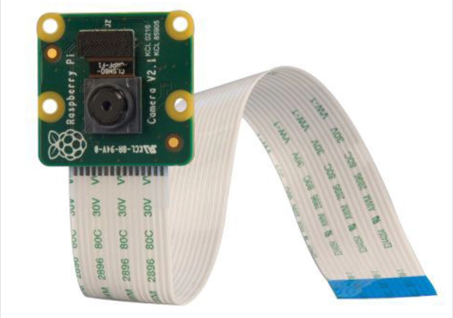
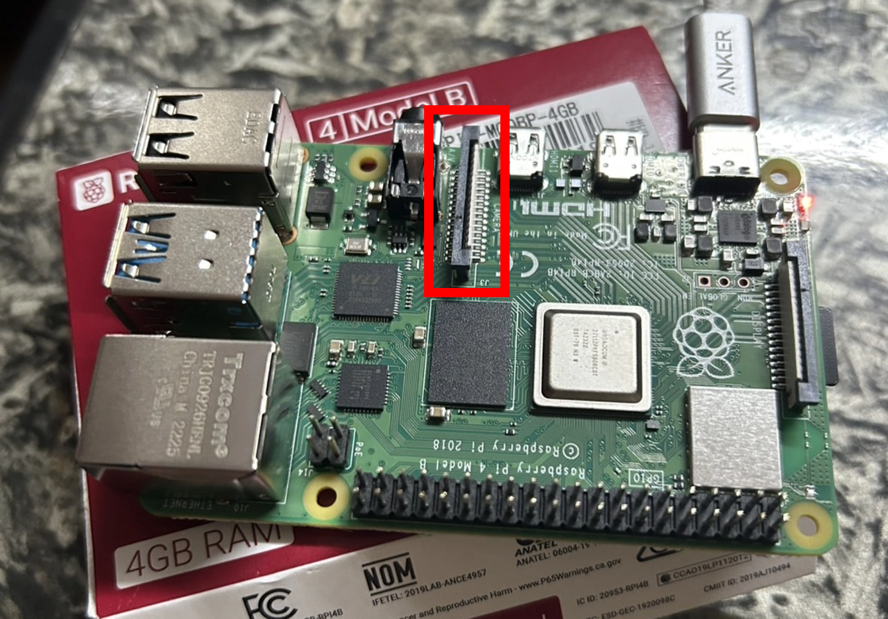

# Raspberry Pi カメラのセットアップとテスト

このドキュメントでは、Raspberry Pi Camera Module のインストールと動作確認の方法を説明します。

参考資料:
- [Raspberry Pi Camera Software Documentation](https://www.raspberrypi.com/documentation/accessories/camera-software.html)
- [Picamera2 Official Manual (PDF)](https://datasheets.raspberrypi.com/camera/picamera2-manual.pdf)

## 1. カメラモジュールの取り付け

カメラを接続する前に、**必ず Raspberry Pi の電源を切り、電源ケーブルを取り外してください**。

1. 下図のように、Raspberry Pi 上のカメラコネクタ（CSI）を確認します。
2. 黒いロック機構をゆっくりと引き上げます。
3. カメラのフレキシブルケーブルをコネクタに差し込みます。このとき、青い面が 3.5 mm オーディオジャック側、または Ethernet ポート側を向くようにします。
4. 黒いロック機構を元の位置に押し下げ、ケーブルを固定します。

<div style="width: 100%; max-width: 1200px; margin: 0 auto;">
  <table style="border-collapse: collapse; width: 100%;">
    <tr>
      <td style="width: 50%; padding: 10px;">
        
        <p style="text-align: center;"><strong>カメラモジュール</strong></p>
      </td>
      <td style="width: 50%; padding: 10px;">
        
        <p style="text-align: center;"><strong>カメラコネクタ CSI</strong></p>
      </td>
    </tr>
  </table>
</div>


## 2. インストールされているカメラユーティリティの確認

Raspberry Pi OS のバージョンによって、使用するカメラユーティリティが異なります。

| Raspberry Pi OS                | カメラユーティリティ |
| ------------------------------ | -------------------- |
| Bullseye (Debian 11、旧バージョン) | `libcamera-hello` |
| Bookworm (Debian 12、Legacy)   | `rpicam-hello`       |
| Trixie (Debian 13) 以降         | `rpicam-hello`       |

注: 以降、**古い OS（Bullseye またはそれ以前）**を **旧 OS** と表記します。

インストールされているユーティリティを確認します。

```bash
# 旧 Raspberry Pi OS (Bullseye)
which libcamera-hello

# 新しい Raspberry Pi OS (Bookworm / Trixie)
which rpicam-hello
```

どちらのコマンドでもパスが表示されない場合は、カメラアプリケーションをインストールします。

```bash
sudo apt update
sudo apt install rpicam-apps
```

**注:** インストールされるユーティリティは、使用している Raspberry Pi OS のバージョンによって異なります。

現在の OS バージョンは、次のコマンドで確認できます。

```bash
cat /etc/os-release
```

例えば、私の Raspberry Pi では次のように表示されます。

```bash
PRETTY_NAME="Raspbian GNU/Linux 13 (trixie)"
VERSION_ID="13"
VERSION="13 (trixie)"
VERSION_CODENAME=trixie
```

このため、`libcamera-hello` ではなく `rpicam-hello` を使用します。

## 3. カメラが認識されているか確認する

カメラを接続し、必要なユーティリティをインストールしたら、Raspberry Pi がカメラを認識しているか確認します。

```bash
# 新しい Raspberry Pi OS
rpicam-hello --list-cameras

# 旧 Raspberry Pi OS
libcamera-hello --list-cameras
```

カメラが正常に認識されると、接続されているカメラの名前や対応解像度などの情報が表示されます。

例えば、次のように表示されます。

```bash
Available cameras
-----------------
0 : imx708_wide [4608x2592 10-bit RGGB] (/base/soc/i2c0mux/i2c@1/imx708@1a)
    Modes: 'SRGGB10_CSI2P' : 1536x864 [120.13 fps - (768, 432)/3072x1728 crop]
                             2304x1296 [56.03 fps - (0, 0)/4608x2592 crop]
                             4608x2592 [14.35 fps - (0, 0)/4608x2592 crop]
```

カメラが認識されない場合は、次の項目を確認してください。

- **フレキシブルケーブル:** ケーブルが正しく挿入されているか確認します（青い面を Ethernet ポート側に向けます）。
- **カメラの互換性:** カメラモジュールが使用している Raspberry Pi のモデルに対応しているか確認します。
- **ソフトウェアの互換性:** 使用している Raspberry Pi OS がカメラインターフェースとドライバースタックに対応しているか確認します。

## 4. カメラプレビューのテスト

カメラが認識されたら、カメラプレビューを表示して正常に動作するか確認します。

```bash
# 新しい Raspberry Pi OS
rpicam-hello

# 旧 Raspberry Pi OS
libcamera-hello
```

デフォルトでは、プレビューは 5000 ミリ秒（5 秒間）表示されます。`-t <duration>` 引数を追加すると、プレビューの表示時間をミリ秒単位で指定できます。

例えば、次のコマンドでは 10 秒間プレビューを表示します。

```bash
# 10 秒間プレビューを表示
rpicam-hello -t 10000
```

プレビューウィンドウが開き、カメラ映像が正しく表示されれば、カメラは正常に動作しています。

## 5. Python API のテスト

Raspberry Pi Camera Module は、`picamera2` ライブラリを使用して制御できます。このライブラリは、標準的な Raspberry Pi OS イメージ（Bullseye、Bookworm、Trixie、およびそれ以降のバージョン）にプリインストールされています。

Minimal インストールなどの理由でライブラリが存在しない場合は、次のコマンドで手動インストールできます。

```bash
sudo apt update
sudo apt install python3-picamera2
```

詳細については、[Picamera2 Official Manual (PDF)](https://datasheets.raspberrypi.com/camera/picamera2-manual.pdf) を参照してください。このセクションでは、一般的な Picamera2 API の使用例を簡単に紹介します。

### 5.1. `camera_test.py` — 基本的なカメラテスト

Picamera2 の初期化、カメラプレビューの設定、および画像のキャプチャ方法を説明します。

- Picamera2 インスタンスを初期化します。
- プレビュー設定を作成して適用します（[picamera_functions.md](picamera_functions_ja.md) の **第3節: カメラプレビュー** を参照）。
- カメラを起動します。
- `switch_mode_and_capture_file()` を使用して画像をキャプチャし、保存します（その他の関数については、[picamera_functions.md](picamera_functions_ja.md) の **第1節: 画像キャプチャ** を参照）。

### 5.2. `camera_test_picamCV.py` — Picamera2 + **OpenCV**

Picamera2 を使用してカメラフレームを取得し、**OpenCV** で表示する方法を説明します。

- Picamera2 を初期化して設定します。
- `capture_array()` を使用し、NumPy 配列としてフレームを取得します（[picamera_functions.md](picamera_functions_ja.md) の **第1節: 画像キャプチャ** を参照）。
- `cv2.imshow()` を使用して、取得したフレームを表示します。
- **OpenCV** による後続の画像処理に利用できる画像フレームを取得します。

### 5.3. `camera_test_video.py` — 動画録画

Picamera2 を使用して動画を録画する方法を説明します。

- 動画録画用にカメラを初期化して設定します。
- ビデオエンコーダ（例: `H264Encoder`）を設定します。
- `start_recording()` を使用して録画を開始します。
- `stop_recording()` を使用して録画を停止します。

注: この動画録画の例は、連続的な映像キャプチャとエンコードを確認するための追加テストです。単純な自律走行レーシングカーの用途では使用しない可能性があります。


## Appendix

### カメラソフトウェア: Legacy V4L2 と Modern libcamera

**旧 Raspberry Pi OS**（Bullseye またはそれ以前など）では、MMAL と Legacy V4L2 カメラドライバーを含む、従来の Broadcom カメラスタックがサポートされていました。

**新しい Raspberry Pi OS**（Bookworm、Trixie、およびそれ以降）では、最新の libcamera ベースのカメラスタックが使用されており、rpicam アプリケーションを通じて利用できます。

**OpenCV ではなぜ重要なのか？**

OpenCV の標準的なカメラインターフェースは、次のように記述します。

```python
import cv2

cap = cv2.VideoCapture(0)
```

通常、`/dev/video0` などの V4L2 ビデオデバイスに依存します。

最新のカメラスタックは V4L2 ビデオデバイスをサポートしていないため、`cv2.VideoCapture(0)` でデバイスを正常にオープンできても、フレームの取得に失敗する場合があります。
