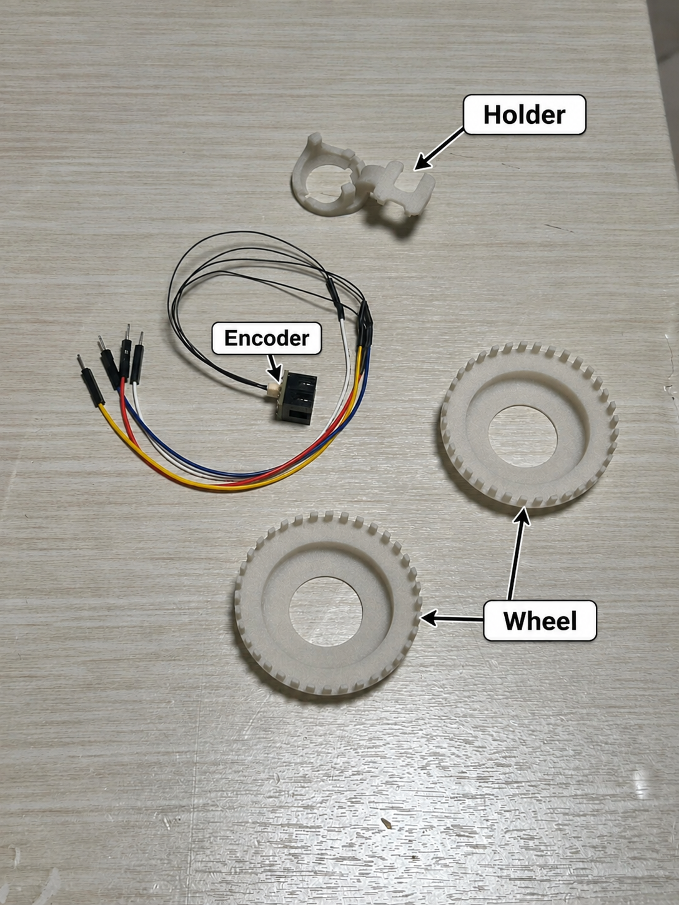
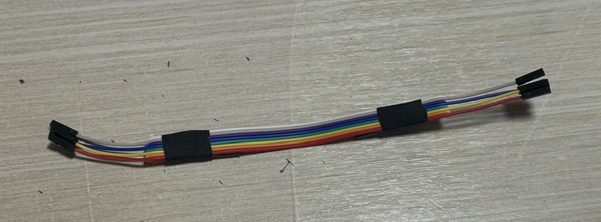
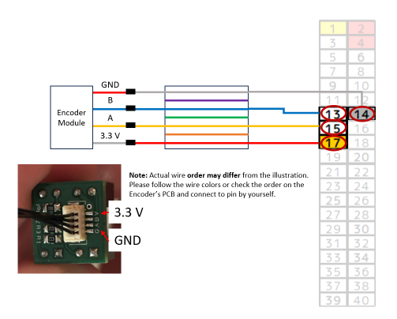
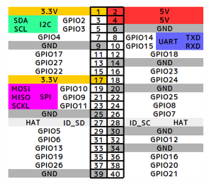
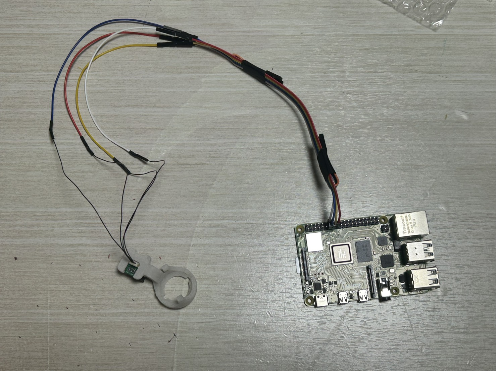
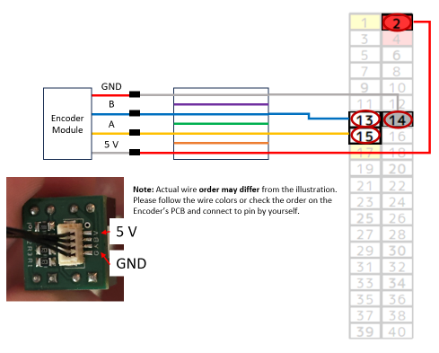
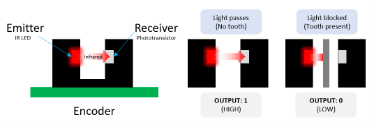
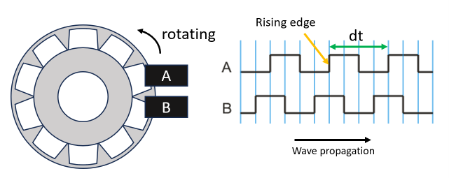

# Raspberry Pi Encoder Setup and Testing
This guide shows how to connect a wheel encoder to a Raspberry Pi 4B, check its signals, and use them to estimate wheel speed.

## 1. Prepare the Equipment
Prepare the following equipment:

- **Encoder module, holder, and encoder wheel**
- **Female-to-female jumper wires** to connect the module to the Raspberry Pi GPIO pins

<div style="width: 100%; max-width: 1200px; margin: 0 auto;">
  <table style="border-collapse: collapse; width: 100%;">
    <tr>
      <td style="width: 50%; padding: 10px;">
        
        <p style="text-align: center;"><strong>Encoder, Holder, and Wheel</strong></p>
      </td>
      <td style="width: 50%; padding: 10px;">
        
        <p style="text-align: center;"><strong>Female-to-Female Jumper Wires</strong></p>
      </td>
    </tr>
  </table>
</div>

## 2. Install the Encoder Module
Before connecting any wires, **shut down the Raspberry Pi and disconnect its power supply**.

1. Attach the encoder to its holder so the edge of the wheel passes through the sensor slot.
2. Connect the encoder to the Raspberry Pi GPIO pins as shown in the wiring diagram below.
3. Use the wire colors to trace each connection, and **check the label on each pin**. The pin order on the module may differ from the diagram.
4. Check all connections before switching on the Raspberry Pi.

<table>
  <tr>
    <td align="center" width="50%">
      
      <br><strong>GPIO Wire Connection</strong>
    </td>
    <td align="center" width="50%">
      
      <br><strong>GPIO Table</strong>
    </td>
  </tr>
</table>

| Encoder signal | BCM GPIO | Physical pin |
| -------------- | -------- | ------------ |
| Encoder A | GPIO 22 | Pin 15 |
| Encoder B | GPIO 27 | Pin 13 |
| GND | GND | Pin 14 |
| VCC | 3.3V (if supported by the module) | Pin 17 |

**Note:** Physical **Pin 6** is another ground pin and can be used in place of Pin 14.

<figure>
  
  <figcaption><strong>Completed Setup</strong></figcaption>
</figure>

### Encoder Power Supply (3.3V or 5V)
1. If the encoder does not respond at 3.3V, set a multimeter to DC voltage. Place the black probe on the encoder’s GND and the red probe on its VCC. If the reading is not close to **3.3V**, check the power wiring first.
2. If the reading is close to **3.3V**, check the encoder’s voltage rating. Try 5V **only if the module is rated for 5V**. Switch off the power, disconnect A and B from the GPIO pins, and move VCC to **physical Pin 2 (5V)**. Then restore power.
3. With A and B still disconnected from the Pi, measure each output relative to GND. Move the encoder wheel slowly, pausing with a tooth and then a gap in the sensor slot. If neither output changes after checking the supply, wiring, and wheel alignment, the encoder may be faulty.

**Important:** Connect A and B directly to the Raspberry Pi only if both outputs are rated **3.3V or lower** at the chosen supply voltage. If either output can reach 5V, use a level shifter or voltage divider. **Never connect a 5V signal directly to a GPIO pin.**

<figure>
  
  <figcaption><strong>Alternative 5V Power Connection <br> (requires a 5V-compatible encoder and GPIO input signals of 3.3V or lower)</strong></figcaption>
</figure>

## 3. Python API Test
Both test scripts use the `RPi.GPIO` Python library to read the encoder. If the library is not installed on Raspberry Pi OS, run the following commands:

```bash
sudo apt update
sudo apt install python3-rpi.gpio
```

Use the first script to check the signals. Then use the second to estimate wheel speed.

### 3.1. `show_encoder_state.py` — Basic Encoder Signal Test

This script displays the current values of encoder channels **A** and **B**. Use these readings to check the sensor response as the wheel turns. The script does **not** calculate speed.

Example output:

```text
A:1 B:1
A:1 B:0
A:0 B:0
A:0 B:1
```

Each channel reads `0` or `1`. As the wheel turns, each tooth blocks the light and each gap allows light to reach the sensor. The readings change as a result. On some modules, both channels read `1` when the light path is clear. **This reading alone does not confirm that the supply voltage is correct.**

Turn the wheel slowly and check that **each channel** changes between `0` and `1`. If the readings do not change, check the power supply and encoder as described in [Encoder Power Supply (3.3V or 5V)](#encoder-power-supply-33v-or-5v).



### 3.2. `speed_observer_mp.py` — Wheel Speed Calculation

This script uses pulses from channel A to estimate wheel speed. It reads channel B to determine the direction of rotation.

**Distance per tooth**

To calculate the distance traveled per tooth, divide the wheel circumference by the number of encoder teeth:

$$
d_{pt} = \frac{2\pi r_w}{n_{teeth}} = \frac{\pi D_w}{n_{teeth}}
$$

where:
- $d_{pt}$ is the distance traveled per tooth (m).
- $r_w$ is the wheel radius (m), and $D_w$ is the wheel diameter (m).
- $n_{teeth}$ is the number of teeth on the encoder wheel.

**Speed estimation**

A **rising edge** occurs when channel A changes from `0` to `1`. To estimate speed, divide the distance per tooth by the time between rising edges recorded for the same direction of rotation:

$$
|v| = \frac{d_{pt}}{\Delta t}
$$

Here, $\Delta t$ is the time between those edges in seconds. The result is in meters per second. The script reports a positive speed for forward motion and a negative speed for backward motion.

**Rotation direction**

At each **rising edge of channel A**, read channel B:

- If **B = 0**, count forward (`+1`).
- If **B = 1**, count backward (`-1`).

If forward motion produces a negative count change, reverse the signs of both the count change and the reported speed.



**Note:** The script counts one edge per tooth. Check that the wheel diameter and tooth count in the script match the hardware. If the script counts more than one edge per tooth, calculate the distance per count by dividing the wheel circumference by the total number of counts per revolution.
