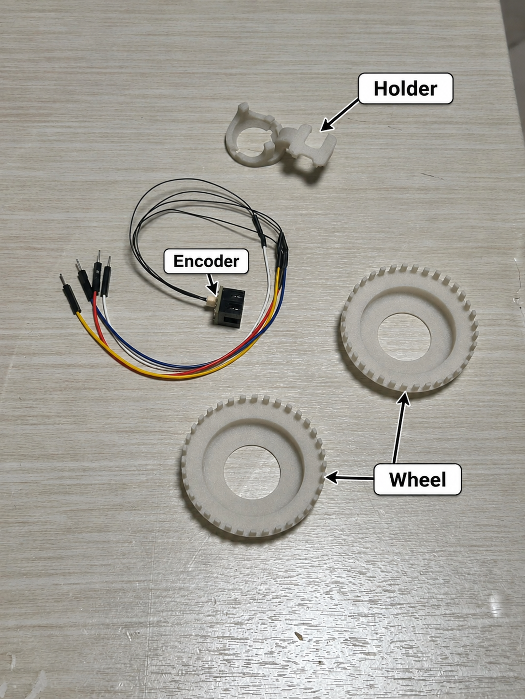
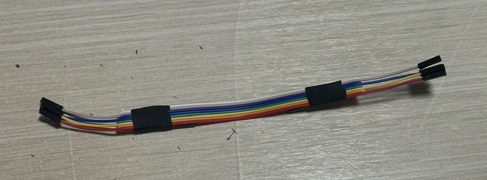
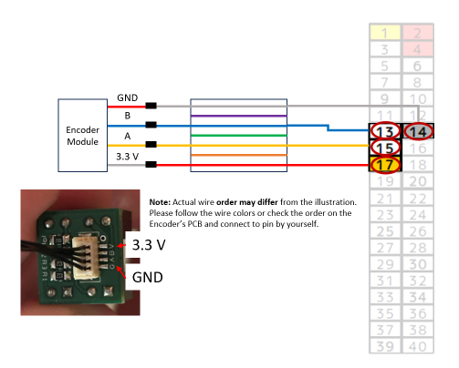
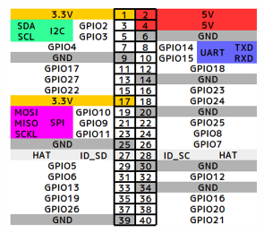
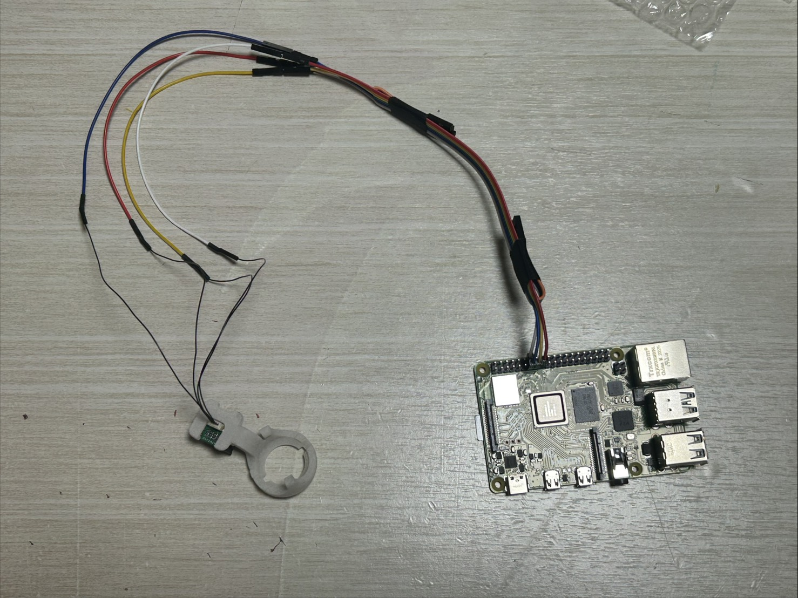
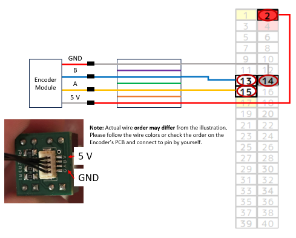
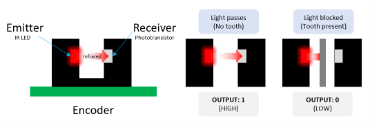
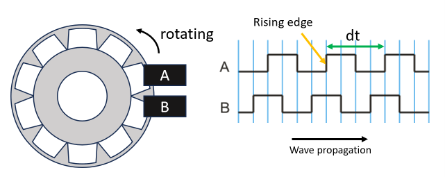

# Raspberry Pi エンコーダの設定とテスト

このガイドでは、車輪用エンコーダを Raspberry Pi 4B に接続し、信号を確認して、車輪の速度を推定する方法を説明します。

## 1. 機材の準備

以下の機材を準備してください。

- **エンコーダモジュール、ホルダー、エンコーダホイール**
- モジュールを Raspberry Pi の GPIO ピンに接続するための**メス－メスのジャンパーワイヤー**

<div style="width: 100%; max-width: 1200px; margin: 0 auto;">
  <table style="border-collapse: collapse; width: 100%;">
    <tr>
      <td style="width: 50%; padding: 10px;">
        
        <p style="text-align: center;"><strong>エンコーダ、ホルダー、ホイール</strong></p>
      </td>
      <td style="width: 50%; padding: 10px;">
        
        <p style="text-align: center;"><strong>メス－メスのジャンパーワイヤー</strong></p>
      </td>
    </tr>
  </table>
</div>

## 2. エンコーダモジュールの取り付け

配線する前に、**Raspberry Pi をシャットダウンし、電源を取り外してください**。

1. エンコーダをホルダーに取り付け、ホイールの端がセンサーのスロットを通るようにします。
2. 下の配線図に従い、エンコーダを Raspberry Pi の GPIO ピンに接続します。
3. 配線図のワイヤーの色を参考にしながら、**各ピンの表示を確認してください**。モジュールのピンの順序は図と異なる場合があります。
4. Raspberry Pi の電源を入れる前に、すべての接続を確認します。

<table>
  <tr>
    <td align="center" width="50%">
      
      <br><strong>GPIO 配線</strong>
    </td>
    <td align="center" width="50%">
      
      <br><strong>GPIO ピン表</strong>
    </td>
  </tr>
</table>

| エンコーダ信号 | BCM GPIO | 物理ピン |
| -------------- | -------- | -------- |
| エンコーダ A | GPIO 22 | ピン 15 |
| エンコーダ B | GPIO 27 | ピン 13 |
| GND | GND | ピン 14 |
| VCC | 3.3V（モジュールが対応している場合） | ピン 17 |

**注:** 物理**ピン 6** も GND ピンであり、ピン 14 の代わりに使用できます。

<figure>
  
  <figcaption><strong>取り付け完了例</strong></figcaption>
</figure>

### エンコーダの電源（3.3V または 5V）

1. 3.3V でエンコーダが反応しない場合は、マルチメーターを直流電圧の測定に設定します。黒いプローブをエンコーダの GND に、赤いプローブを VCC に当てます。測定値が **3.3V** に近くない場合は、まず電源の配線を確認してください。
2. 測定値が **3.3V** に近い場合は、エンコーダの定格電圧を確認します。**モジュールが 5V に対応している場合に限り**、5V を試してください。電源を切り、A と B を GPIO ピンから外して、VCC を**物理ピン 2（5V）**に接続します。その後、電源を入れます。
3. A と B を Raspberry Pi から外したまま、GND を基準に各出力の電圧を測定します。エンコーダホイールをゆっくり回し、センサーのスロットに歯がある位置と隙間がある位置でそれぞれ止めます。電源、配線、ホイールの位置を確認してもどちらの出力も変化しない場合は、エンコーダが故障している可能性があります。

**重要:** 使用する電源電圧において、A と B の両方の出力が **3.3V 以下**と規定されている場合にのみ、Raspberry Pi に直接接続してください。いずれかの出力が 5V に達する可能性がある場合は、レベルシフターまたは分圧回路を使用してください。**5V の信号を GPIO ピンに直接接続しないでください。**

<figure>
  
  <figcaption><strong>5V 電源を使用する場合の接続例 <br>（5V 対応エンコーダと、3.3V 以下の GPIO 入力信号が必要です）</strong></figcaption>
</figure>

## 3. Python API テスト

どちらのテストスクリプトも、エンコーダの読み取りに Python ライブラリ `RPi.GPIO` を使用します。Raspberry Pi OS にインストールされていない場合は、次のコマンドを実行してください。

```bash
sudo apt update
sudo apt install python3-rpi.gpio
```

まず最初のスクリプトで信号を確認し、次に 2 つ目のスクリプトで車輪の速度を推定します。

### 3.1. `show_encoder_state.py` — エンコーダ信号の基本テスト

このスクリプトは、エンコーダの **A** 相と **B** 相の現在の値を表示します。車輪を回したときのセンサーの反応を、この値で確認してください。速度は計算**しません**。

出力例:

```text
A:1 B:1
A:1 B:0
A:0 B:0
A:0 B:1
```

各相は `0` または `1` を示します。車輪が回ると、歯が光を遮り、隙間では光がセンサーに届くため、値が変化します。モジュールによっては、光が遮られていないときに両方の相が `1` を示します。**この値だけでは、電源電圧が正しいことは確認できません。**

車輪をゆっくり回し、**各相**の値が `0` と `1` の間で変化することを確認してください。値が変化しない場合は、[エンコーダの電源（3.3V または 5V）](#エンコーダの電源33v-または-5v)を参照し、電源とエンコーダを確認してください。



### 3.2. `speed_observer_mp.py` — 車輪速度の計算

このスクリプトは A 相のパルスを使って車輪の速度を推定し、B 相を読み取って回転方向を判定します。

**歯 1 枚あたりの移動距離**

歯 1 枚あたりの移動距離を求めるには、車輪の円周をエンコーダの歯数で割ります。

$$
d_{pt} = \frac{2\pi r_w}{n_{teeth}} = \frac{\pi D_w}{n_{teeth}}
$$

各記号の意味は次のとおりです。
- $d_{pt}$: 歯 1 枚あたりの移動距離（m）
- $r_w$: 車輪の半径（m）、$D_w$: 車輪の直径（m）
- $n_{teeth}$: エンコーダホイールの歯数

**速度の推定**

A 相が `0` から `1` に変化することを**立ち上がりエッジ**と呼びます。速度を推定するには、歯 1 枚あたりの移動距離を、同じ回転方向で記録された立ち上がりエッジの時間間隔で割ります。

$$
|v| = \frac{d_{pt}}{\Delta t}
$$

ここで、$\Delta t$ はエッジ間の時間（秒）です。計算結果の単位は m/s です。スクリプトは前進時に正の速度、後退時に負の速度を表示します。

**回転方向**

**A 相の立ち上がりエッジ**ごとに B 相を読み取ります。

- **B = 0** の場合、前進としてカウントします（`+1`）。
- **B = 1** の場合、後退としてカウントします（`-1`）。

前進時にカウントが減少する場合は、カウントの増減と表示速度の両方の符号を反転してください。



**注:** スクリプトは歯 1 枚につき 1 つのエッジをカウントします。スクリプトの車輪直径と歯数が実際の機材と一致していることを確認してください。歯 1 枚につき複数のエッジをカウントする場合は、車輪の円周を 1 回転あたりの総カウント数で割り、1 カウントあたりの距離を求めてください。
