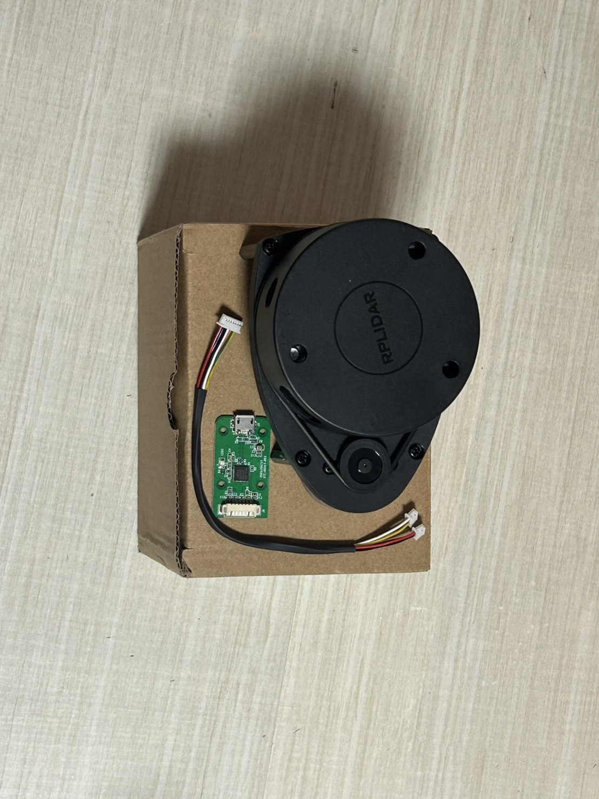
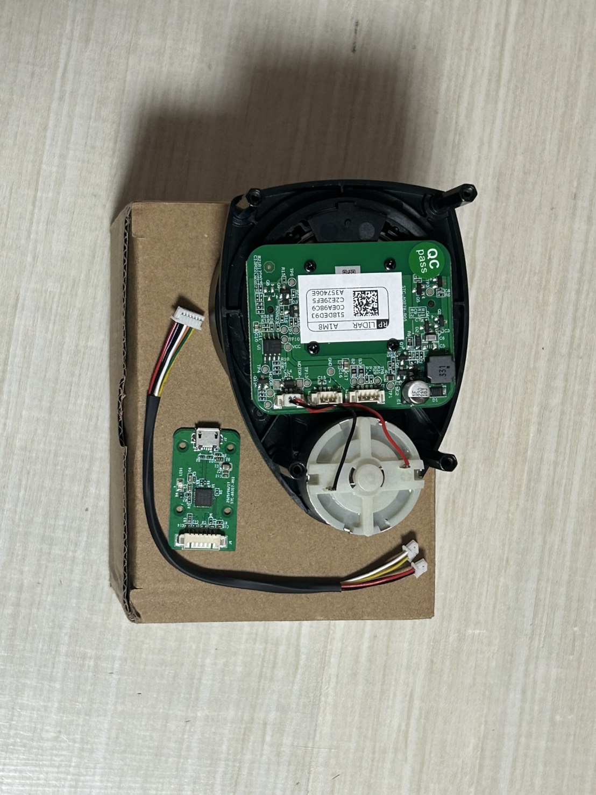
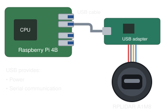
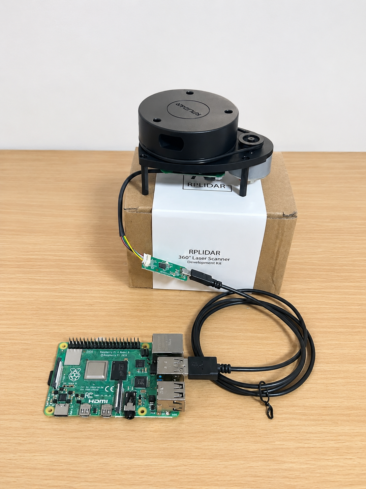
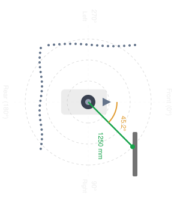
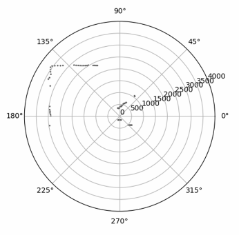

# Raspberry Pi LiDAR Setup and Testing
This document explains how to install and test the RPLiDAR A1 on a Raspberry Pi using a USB adapter board.

Reference:
- [RPLiDAR A1 Development Kit User Manual](https://bucket-download.slamtec.com/3f36d06b9f0064ddaa0575796ad305800b8f9fd3/LM108_SLAMTEC_rplidarkit_usermaunal_A1M8_v2.3_en.pdf)
- [RPLiDAR Python GitHub Repository](https://github.com/Roboticia/RPLidar/tree/master)

## 1. Install the LiDAR Module
Before connecting the LiDAR, **DISCONNECT the power from the Raspberry Pi**.

1. Prepare the RPLiDAR A1, USB adapter board, Micro-USB cable, and Raspberry Pi.
2. Connect the LiDAR to its USB adapter board if it is not already connected.
3. Connect the adapter board to the Raspberry Pi using the Micro-USB cable, following the illustration below.
4. Turn on the Raspberry Pi.

<div style="width: 100%; max-width: 1200px; margin: 0 auto;">
  <table style="border-collapse: collapse; width: 100%;">
    <tr>
      <td style="width: 50%; padding: 10px;">
        
        <p style="text-align: center;"><strong>LiDAR Setup</strong></p>
      </td>
      <td style="width: 50%; padding: 10px;">
        
        <p style="text-align: center;"><strong>LiDAR Connection (Rear View)</strong></p>
      </td>
    </tr>
  </table>
</div>

<div style="width: 100%; max-width: 1200px; margin: 0 auto;">
  <table style="border-collapse: collapse; width: 100%;">
    <tr>
      <td style="width: 50%; padding: 10px;">
        
        <p style="text-align: center;"><strong>LiDAR USB connection illustration</strong></p>
      </td>
      <td style="width: 50%; padding: 10px;">
        
        <p style="text-align: center;"><strong>LiDAR USB connection image</strong></p>
      </td>
    </tr>
  </table>
</div>

## 2. Check LiDAR Detection
After connecting the LiDAR, check whether the Raspberry Pi recognizes the USB adapter board.

```bash
lsusb
```

If the adapter is detected successfully, you should see a USB-to-serial converter in the output. For example:

```text
Silicon Labs CP210x UART Bridge
```

**Note:** The displayed device name may vary depending on the adapter board. If no relevant USB device appears, check the USB cable and connections.

## 3. Check the Serial Port
The LiDAR communicates with the Raspberry Pi through a serial device. To find the device, run:

```bash
ls /dev/ttyUSB*
```

For example:

```text
/dev/ttyUSB0
```

The test programs use `/dev/ttyUSB0` as the default port. If a different port is assigned, change the port name in the Python scripts accordingly.

If you encounter a permission error when accessing the serial port, add your user to the `dialout` group:

```bash
sudo usermod -aG dialout $USER
```

**Log out and log back in** for the group change to take effect.

## 4. Python API Test
The LiDAR can be controlled using the Python `rplidar` library. See the [RPLiDAR Python GitHub Repository](https://github.com/Roboticia/RPLidar/tree/master) for the API and examples.

If the library is not installed, install it in your Python environment:

```bash
pip install rplidar-roboticia
```

On Raspberry Pi OS versions that restrict system-wide pip installations, use a virtual environment instead.

```bash
python -m venv venv
source venv/bin/activate
pip install rplidar-roboticia
```

### 4.1. `RPlidarA1M8_test.py` — Connection, Health, and Scan Test

Use this test first to verify that the Raspberry Pi can communicate with the sensor and read measurements. It prints device information and health, then prints the measurement count and first five measurements for 10 scans before stopping and disconnecting. Press `Ctrl+C` to stop earlier.

Run it from the repository root:

```bash
python scripts/device_test/rccar_tests/test_lidar/RPlidarA1M8_test.py
```

Each measurement is returned as a tuple:

```python
# (quality, angle, distance)
(15, 45.2, 1250.0)
```

| Parameter | Example | Description |
| --------- | ------- | ----------- |
| Quality | `15` | Measurement quality indicator |
| Angle | `45.2°` | Measurement direction in degrees |
| Distance | `1250 mm` | Distance from the LiDAR in millimeters |



**Note:** The LiDAR angle increases clockwise, while the usual Cartesian coordinate convention has positive angles increasing counterclockwise. For a Cartesian frame with positive x at the LiDAR's 0° direction and positive y counterclockwise, invert the sign of the y-coordinate.

For example, to convert a measurement into Cartesian coordinates (meters):

```python
import math


def polar_to_cartesian(angle, distance):
    theta = math.radians(angle)
    distance_m = distance / 1000.0

    x = distance_m * math.cos(theta)
    y = -distance_m * math.sin(theta)

    return x, y
```

### 4.2. `animate.py` — Visualize LiDAR Scans (Additional Test)

The [RPLiDAR `animate.py` example](https://github.com/Roboticia/RPLidar/blob/master/examples/animate.py) shows how to visualize LiDAR measurements in a live polar plot. It can be used to manually check whether the LiDAR detects nearby objects.



The included `animate.py` is adapted from the original example. Instead of reading each scan in the plot update callback, it continuously reads scans in a background thread and plots the latest one. This allows acquisition to continue while the Raspberry Pi draws the visualization and avoids a buildup of unread serial data when plotting is slower than scanning.

### 4.3. `test_obstacle_detection.py` — Detect Obstacles (Additional Test)

Demonstrates obstacle detection within 30° on either side of the LiDAR's 0° direction and up to 500 mm away. It prints the distance to the closest detected obstacle. Adjust `DETECTION_ANGLE` and `DETECTION_DISTANCE` in the script as needed.

**Note:** The LiDAR has a minimum detection range of 100 mm, so it cannot detect objects closer than 100 mm.
