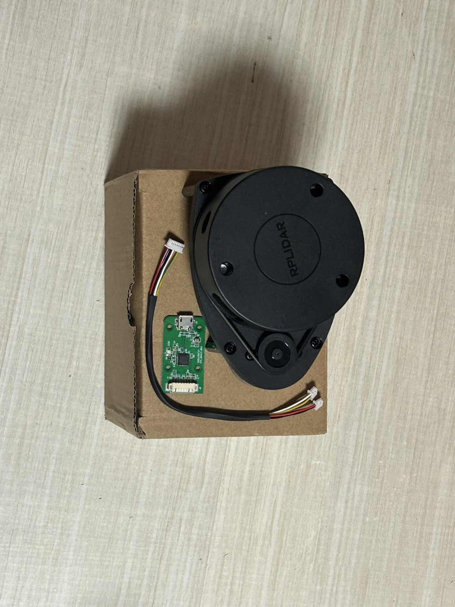
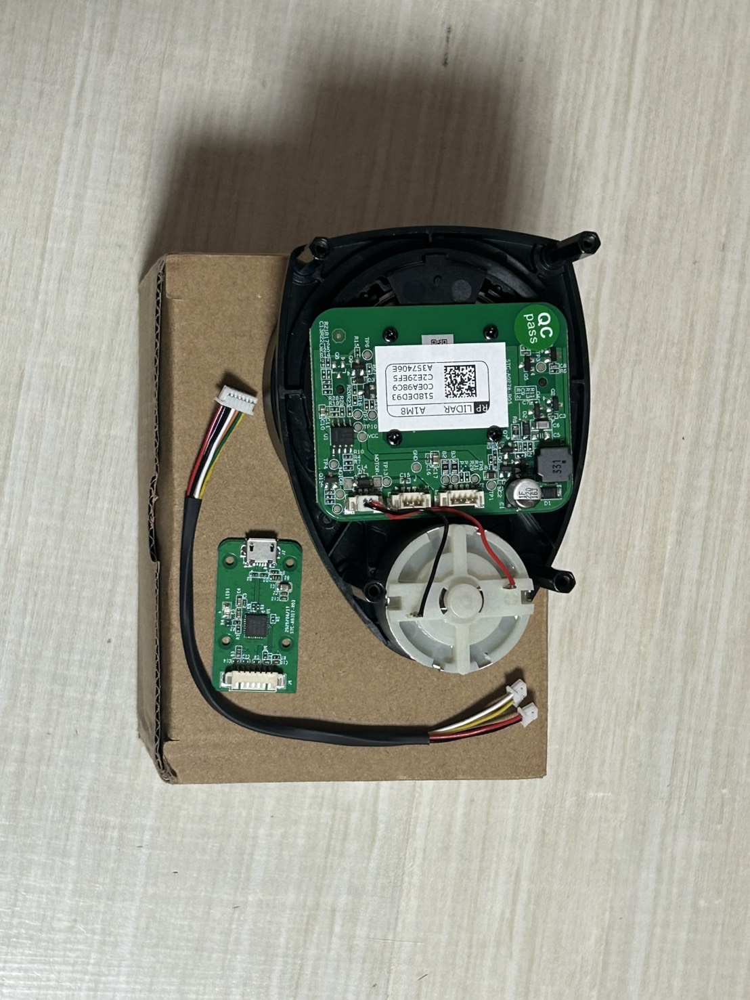
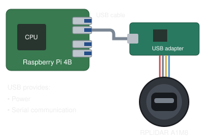
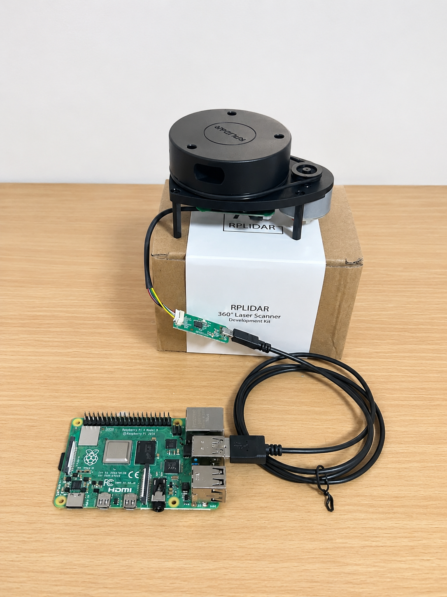
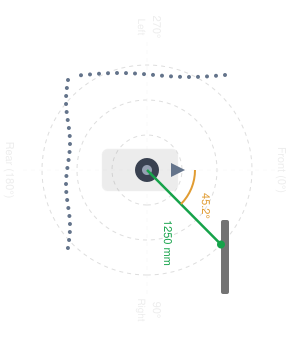
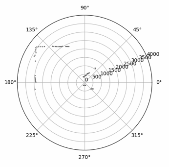

# Raspberry Pi LiDAR のセットアップとテスト

このドキュメントでは、USB アダプターボードを使用して RPLIDAR A1M8 を Raspberry Pi に接続し、動作を確認する方法を説明します。

参考資料:
- [RPLIDAR A1 開発キットユーザーマニュアル](https://bucket-download.slamtec.com/3f36d06b9f0064ddaa0575796ad305800b8f9fd3/LM108_SLAMTEC_rplidarkit_usermaunal_A1M8_v2.3_en.pdf)
- [RPLidar Python GitHub リポジトリ](https://github.com/Roboticia/RPLidar/tree/master)

## 1. LiDAR モジュールの取り付け

LiDAR を接続する前に、**Raspberry Pi の電源を切り、電源を取り外してください**。

1. RPLIDAR A1M8、USB アダプターボード、Micro-USB ケーブル、Raspberry Pi を用意します。
2. LiDAR が USB アダプターボードに接続されていない場合は、接続します。
3. 下図を参考に、Micro-USB ケーブルでアダプターボードを Raspberry Pi に接続します。
4. Raspberry Pi の電源を入れます。

<div style="width: 100%; max-width: 1200px; margin: 0 auto;">
  <table style="border-collapse: collapse; width: 100%;">
    <tr>
      <td style="width: 50%; padding: 10px;">
        
        <p style="text-align: center;"><strong>LiDAR のセットアップ</strong></p>
      </td>
      <td style="width: 50%; padding: 10px;">
        
        <p style="text-align: center;"><strong>LiDAR の接続（背面）</strong></p>
      </td>
    </tr>
    <tr>
      <td style="width: 50%; padding: 10px;">
        
        <p style="text-align: center;"><strong>LiDAR の USB 接続図</strong></p>
      </td>
      <td style="width: 50%; padding: 10px;">
        
        <p style="text-align: center;"><strong>LiDAR の USB 接続写真</strong></p>
      </td>
    </tr>
  </table>
</div>

## 2. LiDAR の認識確認

LiDAR を接続したら、Raspberry Pi が USB アダプターボードを認識しているか確認します。

```bash
lsusb
```

正常に認識されていれば、次の例のように USB シリアル変換器が表示されます。

```text
Silicon Labs CP210x UART Bridge
```

**注:** 表示されるデバイス名はアダプターボードによって異なります。該当する USB デバイスが表示されない場合は、USB ケーブルと接続を確認してください。

## 3. シリアルポートの確認

LiDAR はシリアルデバイスを通じて Raspberry Pi と通信します。デバイスを確認するには、次のコマンドを実行します。

```bash
ls /dev/ttyUSB*
```

表示例:

```text
/dev/ttyUSB0
```

テストプログラムでは `/dev/ttyUSB0` を既定のポートとして使用します。別のポートが割り当てられている場合は、Python スクリプト内のポート名を変更してください。

シリアルポートへのアクセスで権限エラーが発生した場合は、ユーザーを `dialout` グループに追加します。

```bash
sudo usermod -aG dialout $USER
```

変更を反映するには、**ログアウトして再度ログインしてください**。

## 4. Python API テスト

Python の `rplidar` ライブラリを使って LiDAR を制御できます。API と使用例については、[RPLidar Python GitHub リポジトリ](https://github.com/Roboticia/RPLidar/tree/master)を参照してください。主な関数は [RPLidar の基本関数](lidar_functions_ja.md)でも紹介しています。

ライブラリがインストールされていない場合は、Python 環境にインストールします。

```bash
pip install rplidar-roboticia
```

システム全体への pip インストールが制限されている Raspberry Pi OS では、代わりに仮想環境を使用します。

```bash
python -m venv venv
source venv/bin/activate
pip install rplidar-roboticia
```

### 4.1. `RPlidarA1M8_test.py` — 接続・状態・スキャンのテスト

まずこのテストを使って、Raspberry Pi がセンサーと通信し、測定値を取得できることを確認します。デバイス情報と状態を表示した後、10 スキャンについて測定数と先頭 5 件の測定値を表示し、停止して切断します。途中で停止するには `Ctrl+C` を押してください。

リポジトリのルートから実行します。

```bash
python scripts/device_test/rccar_tests/test_lidar/RPlidarA1M8_test.py
```

各測定値は次のタプルとして返されます。

```python
# (quality, angle, distance)
(15, 45.2, 1250.0)
```

| 項目 | 例 | 説明 |
| ---- | --- | ---- |
| Quality | `15` | 測定品質を示す値 |
| Angle | `45.2°` | 測定方向（度） |
| Distance | `1250 mm` | LiDAR からの距離（ミリメートル） |



**注:** LiDAR の角度は時計回りに増加しますが、通常の直交座標系では正の角度は反時計回りに増加します。LiDAR の 0° 方向を正の x 軸、反時計回りを正の y 軸とする直交座標系では、y 座標の符号を反転します。

例えば、測定値を直交座標（メートル）に変換するには、次のようにします。

```python
import math


def polar_to_cartesian(angle, distance):
    theta = math.radians(angle)
    distance_m = distance / 1000.0

    x = distance_m * math.cos(theta)
    y = -distance_m * math.sin(theta)

    return x, y
```

### 4.2. `animate.py` — LiDAR スキャンの可視化（追加テスト）

[RPLidar の `animate.py` サンプル](https://github.com/Roboticia/RPLidar/blob/master/examples/animate.py)は、LiDAR の測定値をリアルタイムの極座標プロットに表示します。近くの物体を検出できているかを目視で確認できます。



付属の `animate.py` は元のサンプルを改良したものです。プロットの更新コールバックでスキャンを読み取る代わりに、バックグラウンドスレッドで継続的にスキャンを取得し、最新のスキャンを表示します。これにより、Raspberry Pi が描画している間も取得を続けられ、描画がスキャンより遅い場合に未読のシリアルデータが蓄積するのを防ぎます。

### 4.3. `test_obstacle_detection.py` — 障害物の検出（追加テスト）

LiDAR の 0° 方向から左右それぞれ 30° 以内、距離 500 mm 以内の障害物を検出し、最も近い障害物までの距離を表示します。必要に応じてスクリプト内の `DETECTION_ANGLE` と `DETECTION_DISTANCE` を調整してください。

**注:** LiDAR の最小検出距離は 100 mm のため、それより近い物体は検出できません。
